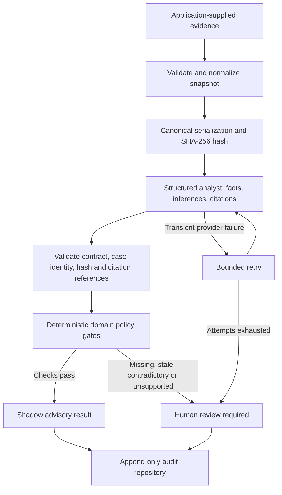

# Verification-First AI Adjudication Pipeline

A general-purpose pipeline for evidence-backed AI reviews. An analyst proposes a structured interpretation; deterministic code checks the evidence and policy before routing the case to an advisory result or human review.

Extracted and generalized from the responsibility-review system built for [RCS Travels](https://github.com/Divyansh-0909/RCS-Travels-Website). The example domain here is a synthetic support-return dispute. Evidence categories and case policies are configurable.

## Run it

Requires Node.js 20 or later.

```sh
git clone https://github.com/Divyansh-0909/verification-first-ai-adjudication-pipeline.git
cd verification-first-ai-adjudication-pipeline
npm ci
npm test
npm run demo
```

The demo uses a deterministic fake analyst and synthetic records. It makes no model API requests and requires no API key.

## How a case moves through the pipeline



The pipeline is advisory. Its outputs do not execute refunds, penalties, account restrictions, or final adjudications.

## What is reusable

- **Evidence journal:** stable evidence identities, source and derivation metadata, normalized timestamps, deterministic ordering, and immutable snapshots.
- **Analysis contract:** structured facts and inferences with evidence references, explicit uncertainty, contradictions, and missing evidence.
- **Verification:** schema validation, snapshot hash binding, case identity checks, citation existence, and contradiction checks.
- **Policy gates:** configurable case allowlists, required and fresh evidence, classification/action compatibility, severity rules, and confidence thresholds.
- **Shadow processing:** bounded transient retries, repeat-work deduplication, and audited advisory or human-review outcomes.
- **Provider boundary:** injected analysts for tests or other model providers, plus an optional OpenAI structured-output adapter.

Start with [the runnable example](examples/support-return-dispute.js), then replace its categories, policy, and analyst with your application's inputs. [The tests](test/pipeline.test.js) exercise failure cases as well as the successful route.

## Model integration

The optional OpenAI adapter uses the Responses API with a structured schema. It requires an explicitly chosen model; the package does not assume model availability or select a production model for you. See [OpenAI's Structured Outputs documentation](https://developers.openai.com/api/docs/guides/structured-outputs).

Use server-side credentials or an injected authenticated client. Keep credentials out of source, examples, evidence snapshots, and audit data. A live provider call can incur charges; `npm test` and `npm run demo` do not make one.

To replace the fake analyst in the example:

```js
import OpenAI from "openai";
import { createOpenAIAdapter } from "./src/index.js";

const analyst = createOpenAIAdapter({
  client: new OpenAI({
    apiKey: process.env.OPENAI_API_KEY,
    maxRetries: 0, // The adjudicator owns retries.
    timeout: 60_000,
  }),
  model: process.env.OPENAI_MODEL,
});
```

Pass this `analyst` to `createShadowAdjudicator` alongside your policy and evidence bundle, following the demo. The default retry delay is exponential (30 seconds, then 60 seconds, capped at 15 minutes), with three total attempts. Tests inject a fake delay. Unstructured, schema-invalid, or semantically invalid outputs go to human review; storage failures propagate rather than being relabeled as model failures.

## What verification establishes

A matching hash establishes that the analysis refers to the normalized snapshot being evaluated. An existing citation establishes that its evidence ID belongs to that snapshot. These checks **do not prove that an evidence source is truthful or that a cited statement is semantically supported**. Evidence ingestion must come from a trusted application boundary, and ambiguous interpretations still require human review.

The analyst's confidence is a routing input, not a calibrated probability. Structured output is a format guarantee, not a correctness guarantee.

## Scope and validation status

This release contains a generic executable review core and an in-memory repository for local use. The RCS implementation also has application-specific database leases, scheduled sweeps, administrative decisions, appeals, and consequence handling. Those integrations are deliberately kept in the application; they are not automatically supplied by this standalone package.

The in-memory repository loses records on process exit. Deduplication within one adjudicator does not establish exactly-once processing across multiple processes. A deployed adapter needs persistent records, atomic uniqueness/claims, retention controls, and application authentication.

A repository adapter implements `findByKey(key)` and `append(record)`, either synchronously or as promises. `append` returns `{ created, record }` and must enforce uniqueness on `record.idempotencyKey`; stored records must be append-only. Across multiple workers, an atomic work claim must happen before the provider call as well. Increment `policyVersion` whenever rules change. The adjudicator captures an immutable policy configuration at construction time, and persisted replay keys include the case, evidence hash, policy version and analysis contract version.

Evidence `quality.provenance` is optional when the trusted ingestion boundary supplies an explicit source. If present, it accepts `trusted`, `verified`, `direct` or `derived`; missing/untrusted/unknown labels and invalid-quality flags require human review. Provenance labels are application assertions, not cryptographic source authentication.

The shipped test suite and example use synthetic evidence and mocked model responses. No live model comparison or real human-labeled production accuracy result is claimed. Shadow results are intended for evaluation and review, and do not establish readiness for automatic adjudication.

See [PROVENANCE.md](PROVENANCE.md) for the relationship to the original implementation.
